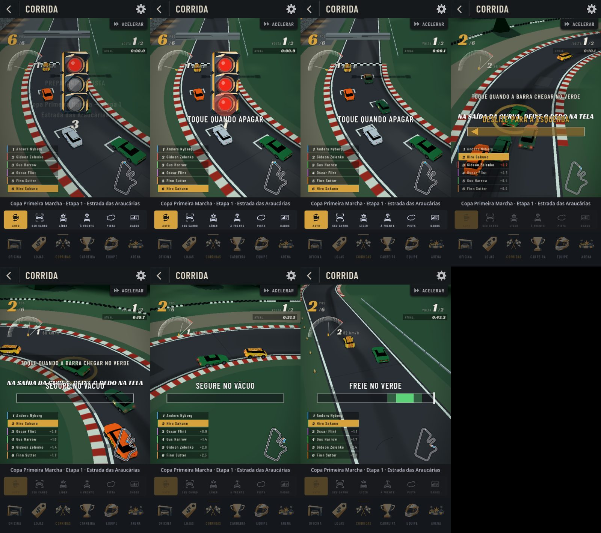
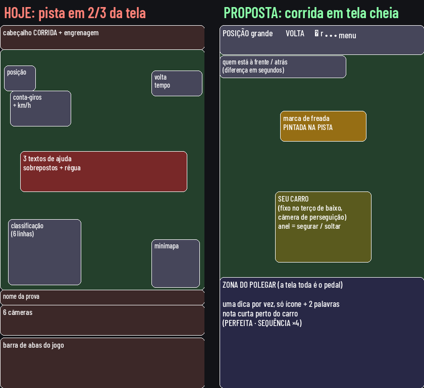

# Revisão completa da corrida (proposta)

Pedido do usuário (2026-10-22): "a jogabilidade na corrida está péssima, tem muita informação
sobrescrita, pouca participação; estudar jogos com controles parecidos e reestruturar a corrida
inteira: câmeras, posição do HUD, tudo".

## 1. Diagnóstico (demo publicada, celular em retrato, 405×720)

Fotos tiradas em sequência numa prova da Copa Primeira Marcha, sem tocar na tela:

1. **A pista ocupa só 2/3 da tela.** Cabeçalho, nome da prova, seletor de 6 câmeras e a barra de
   abas do jogo comem o terço de baixo, que é justamente onde fica o polegar.
2. **Texto sobre texto.** No meio da tela aparecem ao mesmo tempo a dica da freada ("TOQUE QUANDO A
   BARRA CHEGAR NO VERDE"), a da saída ("NA SAÍDA DA CURVA, DEIXE O DEDO NA TELA") e a da defesa
   ("DESLIZE PARA A ESQUERDA"), em cima da régua e do carro. No vácuo, "SEGURE NO VÁCUO" fica sobre
   a dica da saída. Na largada, o semáforo fica sobre "PREPARANDO A PISTA" e o nome da prova.
3. **Uma régua só para seis gestos diferentes.** Tocar (freada), segurar (saída), segurar e soltar
   (vácuo), deslizar (defesa), tocar no apagar (largada) e botões (forçar/poupar) usam a mesma
   barra no meio da tela, com textos diferentes. O jogador precisa ler para saber o que fazer.
4. **O olho tem que ir a três lugares.** O carro está no meio, a régua um pouco abaixo dele, a
   classificação embaixo à esquerda e o minimapa embaixo à direita. O conta-giros com os km/h
   fica sobre o número da posição.
5. **A câmera AUTO muda de ângulo e de distância** durante a corrida. Com isso o ponto da freada
   nunca aparece no mesmo lugar da tela.
6. **Pouca participação percebida.** A calibração conta ~40 toques numa corrida pilotada toda,
   mas nas fotos, em 45 s, só uma régua de freada apareceu. Nas retas não há nada para fazer, e
   quando há, vem tudo junto.

## 2. O que os jogos parecidos fazem

Levantamento (fontes no fim): Asphalt 9/Legends (TouchDrive), Mario Kart Tour, Horizon Chase,
CSR Racing 2, Data Wing, Hill Climb Racing, Ridge Racer Slipstream, F1 Clash, F1 Manager, NASCAR
Manager, Motorsport Manager Mobile e Golden Lap.

- **O automático cuida do contínuo, o jogador faz poucos gestos de momento.** Asphalt tem 3
  (drift, nitro, rota), CSR 3 (largada, marcha, nitro), Mario Kart 2 a 3. Nenhum dos estudados
  tem seis tipos de ação ao vivo, como nós.
- **Um mesmo gesto muda de sentido pelo contexto**, em vez de botões novos (Hill Climb: os dois
  pedais giram o carro no ar).
- **A deixa de tempo fica num lugar só.** Barra fixa quando a ação é sempre a mesma (marcha do
  CSR); marca na pista quando depende do lugar (a linha de freada do Forza, que muda de cor antes
  da curva). Nenhum põe a deixa nos dois lugares ao mesmo tempo.
- **A tela toda é o botão** (Data Wing, Hill Climb, Mario Kart em retrato com uma mão).
- **Câmera estável** nos jogos de tempo (Horizon Chase atrás e fixa; CSR, Hill Climb e Data Wing
  fixos). A câmera que muda atrapalha a leitura da deixa.
- **Participação constante sem poluir:** recurso com recarga (nitro, Overtake), sequência que
  some se o jogador parar (combo do Mario Kart Tour) e recompensa do "perfeito" visível no
  resultado (CSR).
- **Nos jogos de gestão ao vivo (F1 Clash, Motorsport Manager), a ordem é um estado que fica
  valendo** (ataque / normal / economia, com cor), não um reflexo. Microgestão demais é a
  crítica mais comum.

## 3. Proposta

### 3.1 Tela e câmera
- **Corrida em tela cheia:** some a barra de abas, o nome da prova e o seletor de câmeras
  durante a corrida. Um botão discreto (•••) no canto abre câmeras, ACELERAR e sair.
- **Câmera de perseguição fixa enquanto há algo para fazer:** atrás e acima do seu carro, que
  fica sempre no mesmo ponto, no terço de baixo, com a pista à frente visível. A câmera AUTO
  (diretor, líder, pista inteira) fica para quem escolhe só assistir, e volta sozinha para a de
  perseguição quando vier uma deixa.

### 3.2 HUD (só três lugares)
- **Faixa de cima:** posição grande à esquerda, volta à direita, o botão •••.
- **Logo abaixo:** só os dois rivais que importam: quem está à frente e quem está atrás, com a
  diferença em segundos. A classificação inteira abre com um toque nessa linha.
- **Perto do carro:** a deixa da vez e a nota (PERFEITA, SEQUÊNCIA ×4), pequenas, saindo do
  próprio carro. Nada mais no meio da tela.
- **Saem:** conta-giros e km/h (já aparecem no som e na velocidade da imagem), minimapa durante a
  ação (fica no •••), o tempo de volta corrido.

### 3.3 Gestos: de seis para três
1. **Segurar na curva (freada e saída num gesto só):** encostar o dedo quando o carro entra na
   faixa de freada pintada na pista e soltar quando aparece a faixa de saída. Encostar = frear,
   soltar = acelerar, como dois pedais. A nota da freada vem de quando encostou; a da saída, de
   quando soltou.
2. **Deslizar para os lados (defesa e ataque):** com rival colado atrás, deslizar para o lado em
   que ele vai sair fecha a porta. Colado em quem está à frente, deslizar para o lado livre é a
   passagem no vácuo (no lugar do segurar e soltar de hoje, que brigava com o segurar da curva).
3. **Tocar na largada:** igual a hoje.
- **Forçar / poupar** (só resistência) vira um estado que fica valendo, com cor no botão ••• :
  ATAQUE / NORMAL / POUPAR, como no F1 Clash, em vez de botões por volta.

### 3.4 Deixas no mundo, não em texto
- A **faixa de freada** é pintada no asfalto à frente (verde no ponto perfeito, amarela na boa)
  com uma placa de contagem (3-2-1) ao lado da pista. A régua no meio da tela sai.
- A **faixa de saída** é pintada no fim da curva, na mesma cor.
- **Vácuo e defesa:** setas no chão ao lado do carro, no lado certo; o rival pisca a seta dele.
- **Texto só na primeira vez** de cada gesto, antes da corrida (cartão com a animação do gesto),
  nunca no meio dela. Na pista, no máximo um ícone e duas palavras.

### 3.5 Participação
- **Sequência:** cada nota boa ou perfeita soma 1; errar ou deixar passar zera. A sequência
  aparece pequena perto do carro e, a partir de um número, dá um pouco de ritmo extra — dentro do
  teto já decidido de +0,5 posição para a corrida toda perfeita (recalibrado).
- **Retas também pedem algo:** a passagem no vácuo e a defesa aparecem nas retas; com a câmera
  fixa e a deixa sempre no mesmo lugar, o jogador vê o que vem.
- **Resultado:** contagem de perfeitas e a maior sequência na janela do resultado.

### 3.6 O que não muda
A simulação continua decidindo a corrida e terminando igual com o app fechado (as ordens já são
gravadas na fila). Os bônus continuam em `data/simulacao.json`, com o mesmo teto.

## 4. Ordem de trabalho

| Fase | O quê | Mede-se com |
| --- | --- | --- |
| R1 | Tela cheia, câmera de perseguição fixa, HUD em três lugares | fotos na demo, FPS |
| R2 | Gestos: segurar na curva, deslizar (defesa e vácuo), largada; fila de uma deixa por vez | testes da simulação e calibrador |
| R3 | Deixas no mundo (faixas pintadas, setas, placa 3-2-1) e nota perto do carro | fotos, `medir_corrida_visual` |
| R4 | Sequência e resultado com perfeitas; recalibrar ao teto | `calibrar_pilotagem.gd` |
| R5 | Cartão de ensino antes da corrida; forçar/poupar como estado | roteiro de teste |

Situação (2026-10-22): R1 a R5 feitas. Ficou de fora a placa 3-2-1 ao lado da pista (o semáforo
do HUD continua sendo a marca da largada). Fotos: `tools/fotos_corrida.gd --deixas=8`.

## 5. Decisões (com a recomendação)

- **C1 — Gestos:** juntar freada e saída num "segurar na curva" e trocar o vácuo por deslizar
  (recomendado: três gestos, como os jogos estudados) ou manter os seis com a tela nova.
- **C2 — Onde fica a deixa:** pintada na pista, perto do carro (recomendado: o olho fica no
  carro; é o padrão da linha de freada) ou barra fixa embaixo (padrão do CSR).
- **C3 — Tela cheia na corrida**, com câmeras e ACELERAR no ••• (recomendado) ou manter a barra
  de abas e o seletor visíveis.
- **C4 — Sequência** com bônus pequeno dentro do teto (recomendado) ou só visual.

## Fontes

Asphalt: gamezebo.com (TouchDrive), toucharcade.com (guia 2018), redbull.com (dicas),
mobilematters.gg (nitro). Mario Kart Tour: mariowiki.com, siliconera.com, macrumors.com,
pocketgamer.com. Horizon Chase: trustedreviews.com, toucharcade.com, gamesasylum.com. CSR Racing:
wikipedia, imore.com, gamezebo.com. Data Wing: toucharcade.com, stuff.tv, gamezebo.com. Hill Climb
Racing: wikipedia. Ridge Racer Slipstream: toucharcade.com, godisageek.com. F1 Clash: hutch.io
(dicas 2023/2025), formula1.com (2026). F1 Manager: motorsportmagazine.com, carscoops.com. NASCAR
Manager: jayski.com. Motorsport Manager Mobile: toucharcade.com, stuff.tv, racefans.net,
gtplanet.net. Golden Lap: traxion.gg, godisageek.com. Linha de freada do Forza: ludo.guide,
forums.forza.net. A pesquisa usou resumos de busca; posições exatas de HUD nos jogos citados não
foram verificadas em vídeo.
